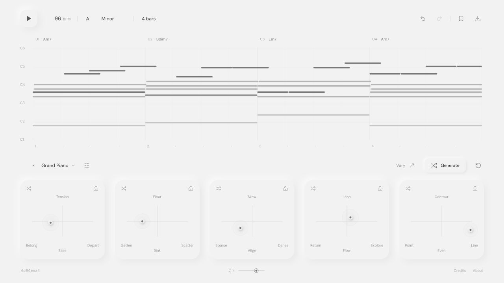
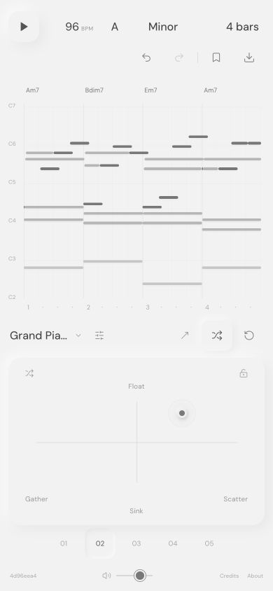

<h1 align="center">loopify.</h1>

<p align="center"><strong>Your next loop starts with a point.</strong></p>
<p align="center"><em>Five maps. Infinite harmonic ideas. Straight into your DAW.</em></p>

<p align="center">
  <a href="https://taewooopark.github.io/loopify/">Open Loopify</a> ·
  <a href="#the-entire-workflow">Workflow</a> ·
  <a href="#the-five-maps">Maps</a> ·
  <a href="#development">Development</a>
</p>

<p align="center">
  
  
  
  
</p>

<p align="center">
  
</p>

## Why `loopify`?

You want a keyboard loop. You have a DAW, an idea, and no MIDI keyboard. Drawing chords one note at a time gets in the way before the idea has a chance to become anything.

Loopify gives you something to react to. Drag a point, listen, keep a bar, try another direction. Harmony, register, rhythm, melodic movement and articulation change together through a deterministic music engine. When a phrase clicks, take the notes or the sound into Logic Pro or another DAW.

No model, API key or account. Generation, sample playback, saves and exports run in your browser.

## Start in 60 seconds

[Open Loopify](https://taewooopark.github.io/loopify/), press Play, and move a point. Choose a sound from the selector below the piano roll. Download MIDI for editable notes, WAV for the sound you hear, or ZIP for both.

On a phone, the five numbered buttons switch between maps. Turn the phone sideways to put the map beside the piano roll. The main instrument fits the viewport; longer settings panels scroll internally.

## The entire workflow

```text
1. Play. Choose a key, mode, tempo and loop length.
2. Move a map. The notes change immediately, even during playback.
3. Lock a map to keep its coordinates. Click a bar to freeze its exact notes.
4. Vary for nearby movement. Generate for another phrase. Explore to roam.
5. Export MIDI, WAV, a project, or a ZIP with everything.
```

MIDI contains notes, velocities, tempo and 4/4 timing. It does not contain an instrument. Import it into a software instrument track in Logic Pro and choose any sound there. WAV captures the selected instrument and effects at 44.1 kHz / 24-bit stereo.

## The five maps

| Map | Horizontal | Vertical | What changes |
|---|---|---|---|
| Gravity | Belong → Depart | Ease → Tension | Harmonic departures, secondary dominants, sevenths and ninths. |
| Space | Gather → Scatter | Sink → Float | Compact vs. open voicings, broken chords, octave spread and register. |
| Pulse | Sparse → Dense | Align → Skew | Sustained chords through sixteenth-note patterns, swing and syncopation. |
| Orbit | Return → Explore | Flow → Leap | Motif repetition, fills, passing tones and melodic interval size. |
| Breath | Point → Line | Even → Contour | Note length, phrase shape and dynamic accents. |

The same seed and coordinates produce the same notes. Each layer has its own random stream so moving a map preserves a phrase's identity. New seeds choose different harmonic paths, comping patterns and melodic motifs. Sound settings also contain the radius used by Vary for each map.

## Control dictionary

| Control | What it does |
|---|---|
| Play / `Space` | Starts or pauses the loop. |
| Generate / `R` | Chooses a new seed at the current coordinates. |
| Vary | Moves unlocked maps within their variation radii and generates a phrase. |
| Explore / `Shift-R` | Chooses new coordinates for every unlocked map. |
| Map lock | Protects that map's coordinates during edits and exploration. |
| Bar label | Freezes the exact note events in that bar. |
| Drag a note | Moves pitch by semitones and time by quarter-beat steps. |
| `⌘Z` / `Ctrl-Z` | Undo. Add Shift to redo. |
| Bookmark | Saves loops in this browser or opens exported JSON / ZIP projects. |
| Export | Downloads MIDI, WAV, project JSON or a complete ZIP. |
| About | Project details, creator and source links. |

Keyboard users can focus either axis of a map and use arrow keys. Notes also respond to arrow keys. Regeneration replaces manual edits in unlocked bars.

## Eighteen sounds, one phrase

| Family | Sounds |
|---|---|
| Sampled instruments | Grand Piano, FM Piano, Marimba, Vibraphone |
| Clean and soft | Sine, Pluck, Glass, Air, Felt |
| Classic electronic | Buzzer, Pulse, Analog |
| Rough and sculpted | Acid, Razor, Rust, Metal, Sub, Hollow |

Acid uses a resonant filter envelope. Razor combines detuned saws with saturation. Rust adds quantized waveshaping. Metal uses inharmonic FM. Sub and Hollow offer darker, more focused alternatives. Tone and Space control the final filter and reverb. Real-time playback and WAV export share the same voice graph.

The four sampled packs are self-hosted: **Salamander Grand Piano** by Alexander Holm (CC BY 3.0), and the **VCSL** FM piano, marimba and vibraphone (CC0). They use a single velocity layer with velocity-dependent gain and nearest-root repitching. See [sample credits](./public/SAMPLE-CREDITS.txt), [source revisions and checksums](./public/samples/SOURCES.json), and [license texts](./public/samples/licenses).

## Keep the idea

| Format | Contents |
|---|---|
| MIDI | Editable notes, velocities, tempo, 4/4 signature and full loop length. |
| WAV | Selected instrument and effects, 44.1 kHz / 24-bit stereo. |
| Project | Notes, seed, map coordinates, locks, sound and settings as JSON. |
| ZIP | `loop.mid`, `loop.wav`, `loopify.json` and `CREDITS.txt`. |

Exact-loop WAV warms up two cycles, then captures one complete cycle for a stable reverb tail. **Include tail** exports a single pass followed by three seconds of decay.

Saves live in local browser storage and are specific to the site's address. To move a loop from another deployment or device, export a project or ZIP there and open it here. Browser storage can be cleared, so export important ideas.

## Field recordings

| The instrument | In your pocket |
|---|---|
|  |  |

## Development

Node.js 24 recommended.

```bash
git clone https://github.com/TaewoooPark/loopify.git
cd loopify
npm ci
npm run dev

npm test
npm run build
npm run preview
```

`src/engine.ts` generates deterministic harmonic loops. `src/audio.ts` schedules native Web Audio voices and renders offline audio. `src/export.ts` writes MIDI, PCM WAV and ZIP files. `src/App.tsx` holds the instrument, local history and project storage.

Pushes to `main` run tests, build Vite's static output and deploy through [GitHub Pages Actions](https://docs.github.com/en/pages/getting-started-with-github-pages/using-custom-workflows-with-github-pages). Relative assets support the `/loopify/` project path. No server or application credentials are required.

Generation currently uses 4/4 with 2, 4 or 8 bars. Audio begins after a user gesture. Mobile layouts are checked at phone and tablet viewport sizes, including landscape; physical iOS and Android hardware testing is separate.

---

Made by [Taewoo Park](https://taewoopark.com) · [GitHub](https://github.com/TaewoooPark)

*Aligning physics, code, and culture toward a civilization-scale solution.*
